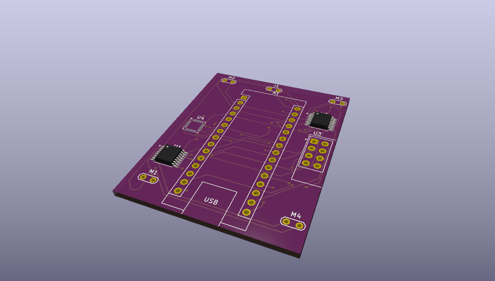

# Mini Arduino Drone

A small drone built with an Arduino Nano, 4 brushed motors, an MPU6050 and an NRF24L01 radio. Includes a custom controller with 2 joysticks and an OLED display.

**Status:** work in progress. The radio link and motor control work. IMU reading and stabilization are not done yet.

---

## Gallery

|                        PCB                        |                                IRL                                |                            3D view                            |
| :-----------------------------------------------: | :---------------------------------------------------------------: | :-----------------------------------------------------------: |
|  |  |  |

---

## Parts

### Drone

| Part                             |  Qty  |
| -------------------------------- | :---: |
| Arduino Nano                     |   1   |
| Coreless DC motor 7×17 mm, 3.7 V |   4   |
| DRV8833 motor driver module      |   2   |
| NRF24L01 radio module            |   1   |
| MPU6050 (GY-521)                 |   1   |
| 5 V fixed boost converter        |   1   |
| 1S LiPo battery, 3.7 V           |   1   |
| 3D-printed frame and propellers  | 1 set |

### Controller

| Part                      | Qty |
| ------------------------- | :-: |
| Arduino Nano              |  1  |
| Analog joystick           |  2  |
| SSD1306 OLED 128×64 (I2C) |  1  |
| NRF24L01 radio module     |  1  |
| 18650 cells               |  2  |

---

## Pinout (drone)

| Nano pin        | Connects to              |
| --------------- | ------------------------ |
| D6              | DRV1 AIN1 (motor 1, PWM) |
| D2              | DRV1 AIN2 (LOW)          |
| D3              | DRV1 BIN1 (motor 2, PWM) |
| D4              | DRV1 BIN2 (LOW)          |
| D5              | DRV2 AIN1 (motor 3, PWM) |
| A0              | DRV2 AIN2 (LOW)          |
| D9              | DRV2 BIN1 (motor 4, PWM) |
| A1              | DRV2 BIN2 (LOW)          |
| D7 / D8         | NRF CE / CSN             |
| D11 / D12 / D13 | NRF MOSI / MISO / SCK    |
| A4 / A5         | MPU6050 SDA / SCL        |
| 5V              | Boost output             |
| 3V3             | NRF VCC                  |

## The AIN2/BIN2 pins are held LOW so each motor only runs in one direction. DRV VM goes to the battery.

## Setup

1. Install the Arduino libraries `RF24`, `Adafruit GFX` and `Adafruit SSD1306`.
2. Upload `firmware/drone/` to the drone and `firmware/controller/` to the controller.

Remove the propellers for first tests.

---
